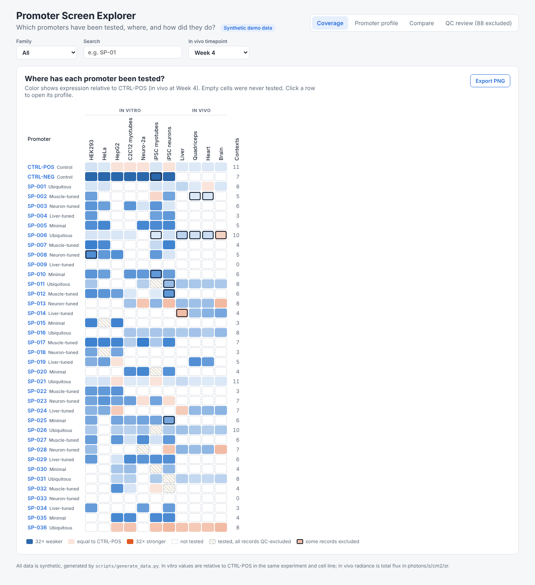
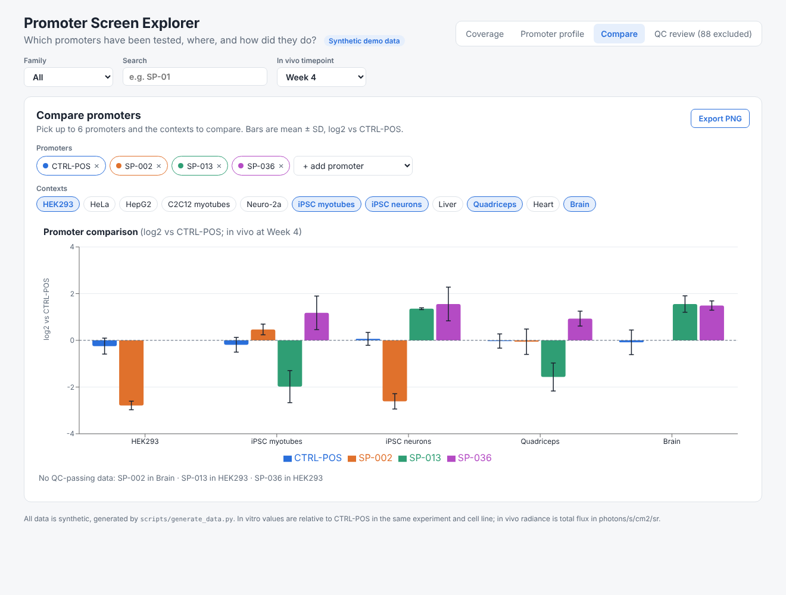

# Promoter Screen Explorer

**Which promoters have been tested, where, and how did they do?**

A React dashboard for gene-therapy promoter screening data. It brings in vitro (flow cytometry) and in vivo (bioluminescence imaging) results into one view, so a team can answer common questions in seconds instead of searching through spreadsheets:

- Has this promoter been tested in this cell type or tissue yet?
- How does it compare with the reference promoter, and with other candidates?
- How much does a conclusion depend on data that failed QC?

> **All data in this repository is synthetic.** It is generated by [`scripts/generate_data.py`](scripts/generate_data.py) from a simple statistical model and is not derived from any real experiment, organization or proprietary dataset. Cell-line and tissue names are generic, public ones.



## Features

| View | What it answers |
| --- | --- |
| **Coverage** | A promoter × context matrix. Color shows expression relative to the reference promoter (CTRL-POS); dashed cells were never tested; hatched cells were tested but every record failed QC. |
| **Promoter profile** | One promoter's expression across all contexts (mean ± SD), which contexts are still untested, and which of its records carry QC flags. |
| **Compare** | Up to six promoters side by side across chosen contexts, as grouped bars with error bars. Missing data is listed explicitly instead of silently dropped. |
| **QC review** | Turn each QC flag type on or off. Every view recalculates immediately, so you can see whether a result holds up without questionable data. |
| **Export** | Each chart panel exports as a high-resolution PNG, ready for a slide. |



## How the numbers are computed

- **In vitro:** each record is already normalized to CTRL-POS in the same experiment and cell line. Values are averaged on the log2 scale across replicates and experiments.
- **In vivo:** radiance is normalized per study, tissue and timepoint to the mean of the QC-passing CTRL-POS animals, then averaged on the log2 scale across animals. The reference itself is recalculated when QC settings change.
- **QC:** flagged records are excluded by default. Excluding a flag removes those records from every summary, and the coverage view shows when a cell's value rests on partly excluded data.

## The synthetic data model

Each promoter gets a latent baseline strength and a family-specific affinity for certain contexts (for example, "muscle-tuned" promoters are stronger in myotubes and quadriceps and weaker off-target). Observed values are noisy replicate draws around that signal. Coverage is deliberately incomplete, as in a real screen, and a small number of runs carry planted QC problems with distorted values so the QC controls have a visible effect. The generator is seeded, so the dataset is reproducible.

## Run it locally

```bash
npm install
npm run dev            # http://localhost:5173
python3 scripts/generate_data.py   # optional: regenerate the synthetic dataset
```

## Stack

React 19 + TypeScript (Vite), Recharts for charts, html-to-image for PNG export. Data is a static JSON file, so the app can be deployed to any static host (for example GitHub Pages).

## Background

I work in AAV gene therapy. In promoter screening, results are spread across flow cytometry exports, imaging files and study metadata, so "has anyone tested this yet?" becomes a recurring team question. This project is an independent, public demonstration of a tool that answers it, built with AI coding assistance (Claude).

## License

MIT
